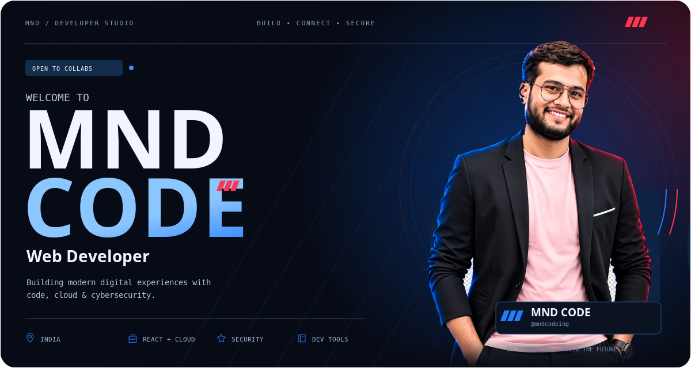

## 🚀 Selected Projects

| Project | Description | Live |
|---|---|---|
| **MND CODE** | Web development and learning platform | [Open website](https://mndweb.vercel.app/) |
| **MND Music** | Music player web application | [Open website](https://mnd-music-player.vercel.app/) |
| **MND Coding NCC** | NCC-focused web project | [Open website](https://mnd-coding-ncc.vercel.app/) |
| **Girls Hostel** | Girls hostel website project | [Open website](https://girls-hostel-gray.vercel.app/) |
| **Nutrino** | Health and fitness information platform | [Open website](https://nutrino-delta.vercel.app/) |
| **TechFlix OTT** | OTT-style streaming platform project | [Open website](https://otttechflix.vercel.app/) |

*Project descriptions are concise summaries; visit each live site to explore its current features.*

## 🏆 Achievements

- **Flipkart GRiD 7.0** — National Semi-Finalist
- **Myntra WeForShe HackerRamp 2025** — Top 100 teams

## 🎓 Education

**Bachelor of Computer Applications (BCA)**  
Artificial Intelligence and Machine Learning  
**CGPA:** 9.10

## 📸 A Few More Photos

  
  
  
   
  
  
  

## 📊 GitHub

Explore my repositories to see what I’m building and learning. GitHub statistics and contribution widgets are intentionally not embedded here so the profile does not display unverified or third-party-generated numbers.

## 🌐 Connect

- **GitHub:** [@ipsmnd](https://github.com/ipsmnd)
- **Website:** [MND CODE](https://mndweb.vercel.app/)
- **Facebook:** [mndcoding](https://www.facebook.com/mndcoding)
- **X:** [@mndcodeding](https://x.com/mndcodeding)

---

  
  Designed with care · Built with curiosity · Always improving

